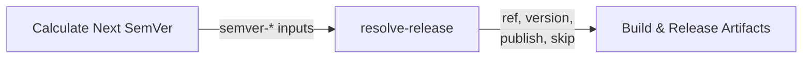
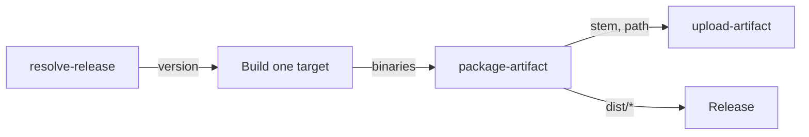

# Configuration Reference

Reference for [`resolve-release`](../resolve-release/action.yml) and
[`package-artifact`](../package-artifact/action.yml).

- [`resolve-release`](#resolve-release) — decides and performs the release.
- [`package-artifact`](#package-artifact) — builds the archive for one target.

## resolve-release

### How it fits together

The action runs inside the caller's `prepare` job, against the checkout the
caller already made, and writes four step outputs for the build job:



The semver outputs are inputs to this action, so the workflow must run
`ietf-tools/semver-action` first and pass its results through `semver-*`.

### Inputs

| Input | Default | Description |
|---|---|---|
| `ref` | `""` | Dispatch ref: empty, a commit SHA (7–64 hex), or `vX.Y.Z`. |
| `dry-run` | `false` | Preview the run without mutating anything. |
| `gate-sha` | `""` | Commit the CI gate approved. Shipping refuses if `HEAD` no longer matches. Ignored for `ref` dispatch, which pins its own commit. |
| `manifest-path` | `Cargo.toml` | File holding the source-of-truth version, used to recover a lost tag. Empty disables recovery. |
| `bump-command` | `just bump` | Command that rewrites the version files; the new version is passed as its first argument. Empty means manifest-less. |
| `semver-bump` | `""` | Bump type from `semver-action` (`major`, `minor`, `patch`, `none`). |
| `semver-current` | `""` | Current version from `semver-action`. |
| `semver-next` | `""` | Next version including the `v` prefix. |
| `semver-next-strict` | `""` | Next version without the `v` prefix. |

#### The two project-specific inputs

`manifest-path` and `bump-command` are the only values that differ between
projects; everything else is the same call.

| Project shape | `manifest-path` | `bump-command` |
|---|---|---|
| Version in `Cargo.toml` | `Cargo.toml` | `just bump` |
| Version in a `VERSION` file | `VERSION` | `just bump` |
| Version only in the git tag | `''` | `''` |

### Outputs

| Output | Description |
|---|---|
| `ref` | What the build job checks out: a tag, or a SHA for a test-build. |
| `version` | Version being released, without the `v` prefix. |
| `publish` | `true` when this run should create a release. |
| `skip` | `true` when there is nothing to build. |

Gate the build job on `skip` so a no-op week costs one skipped job:

```yaml
build:
  needs: prepare
  if: needs.prepare.outputs.skip != 'true'
```

### Behaviour

#### Dispatch validation

The `ref` value is classified before anything mutates, so a typo fails the run
instead of silently doing nothing. A `ref` that is neither a SHA nor a
`vX.Y.Z` tag is rejected — including on the dry-run path, so a preview cannot
hide a bad invocation.

#### Nothing ungated is released

On the ship path, `HEAD` must still equal `gate-sha`. If the branch moved
while CI ran, the checkout is code the gate never saw, and the run fails with
the two SHAs. `ref` dispatch pins its own commit and skips this check.

#### A lost tag is recovered

If an earlier run pushed its bump commit and died before tagging, that commit
is not conventional — it reads as "nothing to release" to the next run, which
would then skip. But the manifest is ahead of the latest tag, so the tag is
what is missing. The action tags the stranded commit instead.

Requires `manifest-path` to name a real file with a `version = "…"` line, and
at least one existing `v*` tag. Set `manifest-path: ''` to disable.

#### Nothing is published twice

The calculated version must sort strictly after the latest tag. Anything equal
or behind is refused, so a mis-calculated bump fails loudly rather than
rewriting history.

### Requirements

The caller must provide:

- `actions/checkout` with `fetch-depth: 0` and `persist-credentials: true` —
  the action reads the full tag history and pushes the commit and tag with the
  checkout's credentials.
- `contents: write` on the job.
- `just` on `PATH` when `bump-command` is set.
## package-artifact

### How it fits together

The action runs inside the caller's `build` job, against what that job just
compiled. It writes the archive into `dist/` and uploads it to the run under its
release name:



### Inputs

| Input | Default | Description |
|---|---|---|
| `source` | `""` | Path to a file or directory to package. A directory is packaged whole, recursively. |
| `extra` | `""` | Space-separated additional paths, for a binary plus its launcher script. |
| `name` | — | Artifact base name, e.g. `rsrpc`. Required. |
| `version` | — | Version being released. A leading `v` is dropped. Required. |
| `target` | — | Platform slug, e.g. `x86_64-unknown-linux-gnu`. Required. |
| `format` | `""` | `zip`, `tar.gz`, `tar.xz` or `7z`. Empty picks `zip` on Windows and `tar.gz` elsewhere. |
| `layout` | `dir` | `dir` puts everything under one top-level directory; `flat` places it at the archive root. |
| `output-dir` | `dist` | Where to write the archive. |
| `upload` | `true` | Upload the archive to the Actions run. |
| `upload-action` | `actions/upload-artifact@cf430e0…` | The upload action ref, pinned by the caller so a bump is a deliberate repin. |

### Outputs

| Output | Description |
|---|---|
| `archive` | Archive file name. |
| `path` | Path to the archive, relative to the workspace. |
| `stem` | The `<name>-<version>-<target>` stem. |

### Behaviour

#### The name is always `<name>-<version>-<target>`

Three components, in that order, with the version un-prefixed. Callers holding
`v0.29.0` and `0.29.0` produce the same name. A component containing a path
separator or whitespace is refused rather than sanitised, because a name that
silently became something else is worse than one that failed.

The version is part of the name on purpose: the Homebrew tap bot resolves a
formula's next version by matching release assets against a version-stamped
filename, so an asset without one cannot be tracked at all.

#### Layout decides whether extraction scatters files

`dir` copies everything into one directory named after the archive, so
extracting produces a single folder. `flat` places entries at the archive root,
which is what a launcher script needs when it resolves a sibling by path.
`flat` accepts a single source; several would collide on extraction.

#### The executable bit is recorded, not restored

`actions/download-artifact` strips the executable bit, so a workflow that
chmods after downloading has already lost it. Zip keeps the mode in each
entry's `external_attr` and tar in the header, so both record it at creation
and it survives the round trip. This replaces the
`find -exec chmod +x` step a workflow otherwise needs.

#### An existing archive is replaced

`zipfile` and `tarfile` both open for writing, which truncates, so a retried
step overwrites rather than appends.

### Requirements

- `python3` on the runner. All three of `zip`, `tar` and the stdlib are used
  rather than shelling out, except `7z`, which needs `p7zip-full`.
- `just`-style packaging steps are removed from the caller's build job; the
  action owns staging and archiving.
