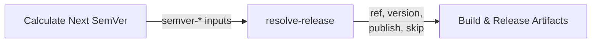

# Configuration Reference

Reference for [`resolve-release`](../resolve-release/action.yml).

## How it fits together

The action runs inside the caller's `prepare` job, against the checkout the
caller already made, and writes four step outputs for the build job:



The semver outputs are inputs to this action, so the workflow must run
`ietf-tools/semver-action` first and pass its results through `semver-*`.

## Inputs

| Input | Default | Description |
|---|---|---|
| `ref` | `""` | Dispatch ref: empty, a commit SHA (7–64 hex), or `vX.Y.Z`. |
| `dry-run` | `false` | Preview the run without mutating anything. |
| `gate-sha` | `""` | Commit the CI gate approved. Shipping refuses if `HEAD` no longer matches. Ignored for `ref` dispatch, which pins its own commit. |
| `manifest-path` | `Cargo.toml` | File holding the source-of-truth version, used to recover a lost tag. Empty disables recovery. |
| `bump-command` | `just bump` | Command that rewrites the version files; the new version is passed as its first argument. Empty means manifest-less. |
| `semver-bump` | `""` | Bump type from `semver-action` (`major`, `minor`, `patch`, `none`). |
| `semver-current` | `""` | Current version from `semver-action`. |
| `semver-next` | `""` | Next version including the `v` prefix. |
| `semver-next-strict` | `""` | Next version without the `v` prefix. |

### The two project-specific inputs

`manifest-path` and `bump-command` are the only values that differ between
projects; everything else is the same call.

| Project shape | `manifest-path` | `bump-command` |
|---|---|---|
| Version in `Cargo.toml` | `Cargo.toml` | `just bump` |
| Version in a `VERSION` file | `VERSION` | `just bump` |
| Version only in the git tag | `''` | `''` |

## Outputs

| Output | Description |
|---|---|
| `ref` | What the build job checks out: a tag, or a SHA for a test-build. |
| `version` | Version being released, without the `v` prefix. |
| `publish` | `true` when this run should create a release. |
| `skip` | `true` when there is nothing to build. |

Gate the build job on `skip` so a no-op week costs one skipped job:

```yaml
build:
  needs: prepare
  if: needs.prepare.outputs.skip != 'true'
```

## Behaviour

### Dispatch validation

The `ref` value is classified before anything mutates, so a typo fails the run
instead of silently doing nothing. A `ref` that is neither a SHA nor a
`vX.Y.Z` tag is rejected — including on the dry-run path, so a preview cannot
hide a bad invocation.

### Nothing ungated is released

On the ship path, `HEAD` must still equal `gate-sha`. If the branch moved
while CI ran, the checkout is code the gate never saw, and the run fails with
the two SHAs. `ref` dispatch pins its own commit and skips this check.

### A lost tag is recovered

If an earlier run pushed its bump commit and died before tagging, that commit
is not conventional — it reads as "nothing to release" to the next run, which
would then skip. But the manifest is ahead of the latest tag, so the tag is
what is missing. The action tags the stranded commit instead.

Requires `manifest-path` to name a real file with a `version = "…"` line, and
at least one existing `v*` tag. Set `manifest-path: ''` to disable.

### Nothing is published twice

The calculated version must sort strictly after the latest tag. Anything equal
or behind is refused, so a mis-calculated bump fails loudly rather than
rewriting history.

## Requirements

The caller must provide:

- `actions/checkout` with `fetch-depth: 0` and `persist-credentials: true` —
  the action reads the full tag history and pushes the commit and tag with the
  checkout's credentials.
- `contents: write` on the job.
- `just` on `PATH` when `bump-command` is set.