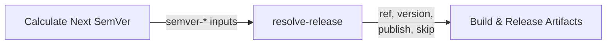
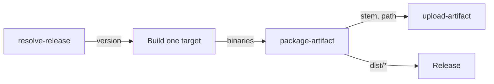

# Configuration Reference

Reference for [`resolve-release`](../resolve-release/action.yml) and
[`package-artifact`](../package-artifact/action.yml).

- [`resolve-release`](#resolve-release) — decides and performs the release.
- [`package-artifact`](#package-artifact) — builds the archive for one target.

## resolve-release

### How it fits together

The action runs inside the caller's `prepare` job, against the checkout the
caller already made, and writes four step outputs for the build job:



The semver outputs are inputs to this action, so the workflow must run
`ietf-tools/semver-action` first and pass its results through `semver-*`.

### Inputs

| Input | Default | Description |
|---|---|---|
| `ref` | `""` | Dispatch ref: empty, a commit SHA (7–64 hex), or `vX.Y.Z`. |
| `dry-run` | `false` | Preview the run without mutating anything. |
| `gate-sha` | `""` | Commit the CI gate approved. Shipping refuses if `HEAD` no longer matches. Ignored for `ref` dispatch, which pins its own commit. |
| `manifest-path` | `Cargo.toml` | File holding the source-of-truth version, used to recover a lost tag. Empty disables recovery. |
| `bump-command` | `just bump` | Command that rewrites the version files; the new version is passed as its first argument. Empty means manifest-less. |
| `semver-bump` | `""` | Bump type from `semver-action` (`major`, `minor`, `patch`, `none`). |
| `semver-current` | `""` | Current version from `semver-action`. |
| `semver-next` | `""` | Next version including the `v` prefix. |
| `semver-next-strict` | `""` | Next version without the `v` prefix. |

#### The `version` recipe contract (language-agnostic)

The action holds no per-language parsing. Every consumer must provide:

```just
# print X.Y.Z (no `v`), or empty for tag-only repos
version get:
  ...

# rewrite all manifests to $1, no commit/tag
version bump ver:
  ...
```

| Project shape | `just version get` | `just version bump` |
|---|---|---|
| Version in `Cargo.toml` | parse `workspace.package` or `package` version | `sed` + `cargo check`/`cargo update -w` |
| Version in `VERSION` | `cat VERSION` | `printf` to `VERSION` |
| Dual `Cargo.toml` + `package.json` | read `Cargo.toml` (single truth) | update both files |

Missing or empty output fails fast.

### Outputs

| Output | Description |
|---|---|
| `ref` | What the build job checks out: a tag, or a SHA for a test-build. |
| `version` | Version being released, without the `v` prefix. A test-build reports `0.0.0-test.<short-sha>`, so the archives it names are unmistakably not a release while still recording which commit they came from. |
| `publish` | `true` when this run should create a release. |
| `skip` | `true` when there is nothing to build. |

Gate the build job on `skip` so a no-op week costs one skipped job:

```yaml
build:
  needs: prepare
  if: needs.prepare.outputs.skip != 'true'
```

### Behaviour

#### Dispatch validation

The `ref` value is classified before anything mutates, so a typo fails the run
instead of silently doing nothing. A `ref` that is neither a SHA nor a
`vX.Y.Z` tag is rejected — including on the dry-run path, so a preview cannot
hide a bad invocation.

#### Nothing ungated is released

On the ship path, `HEAD` must still equal `gate-sha`. If the branch moved
while CI ran, the checkout is code the gate never saw, and the run fails with
the two SHAs. `ref` dispatch pins its own commit and skips this check.

#### A lost tag is recovered

If an earlier run pushed its bump commit and died before tagging, that commit
is not conventional — it reads as "nothing to release" to the next run, which
would then skip. But the manifest is ahead of the latest tag, so the tag is
what is missing. The action tags the stranded commit instead.

Requires `just version get` to print a version ahead of the latest `v*` tag.
Tag-only repos (empty `get`) skip recovery.

#### Nothing is published twice

The calculated version must sort strictly after the latest tag. Anything equal
or behind is refused, so a mis-calculated bump fails loudly rather than
rewriting history.

### Requirements

The caller must provide:

- `actions/checkout` with `fetch-depth: 0` and `persist-credentials: true` —
  the action reads the full tag history and pushes the commit and tag with the
  checkout's credentials.
- `contents: write` on the job.
- `just` on `PATH` with `version get` / `version bump` recipes.

## cargo-cooldown

Gate for scheduled upgrades: reports whether the installed Cargo enforces
`registry.global-min-publish-age` (stable from 1.100). One output, `enforced`.

```yaml
- uses: Delnegend/actions/cargo-cooldown@<sha> # v1
  id: cooldown
- if: steps.cooldown.outputs.enforced == 'true'
  run: cargo update
```

## publish-release

Finishes a release workflow: optionally downloads the consolidated build
artifacts, then creates the GitHub release (or skips it on test-builds).

| Input | Default | Description |
|---|---|---|
| `ref` | — | Tag (or SHA) the build jobs checked out. Required. |
| `publish` | `"false"` | `"true"` creates the release. |
| `download` | `"true"` | `"false"` skips the download step (container releases, freshdesk). |
| `files` | `"artifacts/**/*"` | Release asset glob. |
| `body` / `body-path` | `""` | Inline notes or a notes file. |

```yaml
- uses: Delnegend/actions/publish-release@<sha> # v1
  with:
    ref: ${{ needs.prepare.outputs.ref }}
    publish: ${{ needs.prepare.outputs.publish }}
```

## docker-build-push

Builds a container image with Buildx and pushes it (or loads it locally for
test-builds). Two tags always (`<image>:<version>`, `<image>:latest`),
zstd layers on publish, OCI labels, gha or registry cache. Repo-specific
staging (example configs) and post-build asserts stay in the caller.

| Input | Default | Description |
|---|---|---|
| `image` / `version` | — | Both required. |
| `publish` | `"false"` | Pushes on `"true"`, loads locally otherwise. |
| `target` / `platforms` / `dockerfile` / `context` | `""` / `linux/amd64` / `Dockerfile` / `.` | Build shape. |
| `build-args` | `""` | Newline-separated `KEY=VALUE`. |
| `cache` | `gha` | Or `registry` (`<image>:buildcache`). |

## Reusable workflows

`reusable-auto-merge.yml` (dependabot-style `dependencies` label, optional
`extra-head-prefix`) and `reusable-deps-update.yml` (daily upgrade PRs;
`cargo`/`bun`/`bun-dir` inputs, frozen repos pass both false) replace the
former copy-pasted `auto-merge.yml` / `deps.yml` bodies. Callers keep their
triggers and permissions; the workflow owns concurrency and the PR flow.
## package-artifact

### How it fits together

The action runs inside the caller's `build` job, against what that job just
compiled. It writes the archive into `dist/` and uploads it to the run under its
release name:



### Inputs

A caller supplies only what is unique to their build. Format, compression
effort, directory layout and the archive name are not inputs: each is a decision
a consumer eventually has to handle, and leaving one at the call site is how
`<name>-<target>.zip` and `<name>-<version>-<target>.tar.xz` end up in the same
tap.

| Input | Default | Description |
|---|---|---|
| `source` | `""` | Path to a file or directory to package. A directory is packaged whole, recursively. For a Windows target, `.exe` is appended when the path as given is not there, so a matrix entry names the binary once and never repeats the rule. |
| `extra` | `""` | Space-separated additional paths, for a binary plus its launcher script. |
| `name` | — | Artifact base name, e.g. `rsrpc`. Required. |
| `version` | — | Version being released. A leading `v` is dropped. Required. |
| `target` | — | Platform slug, e.g. `x86_64-unknown-linux-gnu`. Required. |
| `output-dir` | `dist` | Where to write the archive. |
| `upload` | `true` | Upload the archive to the Actions run. |

### What the action decides

| | Choice | Why |
|---|---|---|
| Name | `<name>-<version>-<target>.<ext>` | Version-stamped, so a consumer can match a release asset without hardcoding a target triple. |
| Format | `zip` for a Windows target, `tar.xz` otherwise | Zip is what a Windows user double-clicks; xz is materially smaller on compiled binaries and tar is what a Unix user reaches for. Chosen from the **target's** OS field, not `runner.os`, because a Windows target can be cross-built on a Linux runner. |
| Effort | Maximum for the chosen format | Download bandwidth for every consumer. |
| Layout | One directory named after the archive | Extraction produces a single folder instead of scattering files. |
| Mode | Recorded inside the archive | `download-artifact` strips it, so restoring it afterwards is restoring what the archive lost on the way out. |
| Executable suffix | `.exe` for a Windows target | Derived from `target`, so `source: .../release/rsrpc-cli` finds `rsrpc-cli.exe` on Windows and the bare file elsewhere. An exact path always wins. |

The format follows the target, so the same build produces the same extension
regardless of which runner compiled it.

### Outputs

| Output | Description |
|---|---|
| `archive` | Archive file name. |
| `path` | Path to the archive, relative to the workspace. |
| `stem` | The `<name>-<version>-<target>` stem. |

### Behaviour

#### The name is always `<name>-<version>-<target>`

Three components, in that order, with the version un-prefixed. Callers holding
`v0.29.0` and `0.29.0` produce the same name. A component containing a path
separator or whitespace is refused rather than sanitised, because a name that
silently became something else is worse than one that failed.

The version is part of the name on purpose: the Homebrew tap bot resolves a
formula's next version by matching release assets against a version-stamped
filename, so an asset without one cannot be tracked at all.

#### The executable suffix follows the target

Every compiler appends `.exe` on Windows, so a caller naming a build output
would otherwise carry the same conditional in its matrix. The action derives
it from `target` and tries the plain path first, then the suffixed one, so a
caller that already knows the exact name is never redirected. A path that is
neither fails with both spellings named, because guessing which was tried is
worse than reading it.

`extra` paths go through the same resolution, so a script that does not carry
the suffix is unaffected.

#### The archive is reproducible

Tar records mtimes, so two runs over the same commit would otherwise produce
different bytes and a rebuilt tag would look like a different artifact.
Staging normalises every timestamp, which makes the archive reproducible.
`SOURCE_DATE_EPOCH` overrides the value; it is clamped to 1980 for zip, whose
entries cannot represent anything earlier.

The staging copy is removed afterwards, so the output directory holds only the
archive.

#### The executable bit is recorded, not restored

`actions/download-artifact` strips the executable bit, so a workflow that
chmods after downloading has already lost it. Zip keeps the mode in each
entry's `external_attr` and tar in the header, so both record it at creation
and it survives the round trip. This replaces the
`find -exec chmod +x` step a workflow otherwise needs.

#### An existing archive is replaced

`zipfile` and `tarfile` both open for writing, which truncates, so a retried
step overwrites rather than appends.

### Requirements

- `python3` on the runner. Both archive formats are written with the standard
  library, so nothing needs installing.
- `actions/upload-artifact` is pinned inside the action, not passed in:
  `uses:` takes a literal and rejects an expression, so a caller cannot supply
  the ref. The pin lands here, once, rather than in every consumer.
- The packaging and archiving steps are gone from the caller's build job; the
  action owns them, and nothing needs installing to produce either format.
